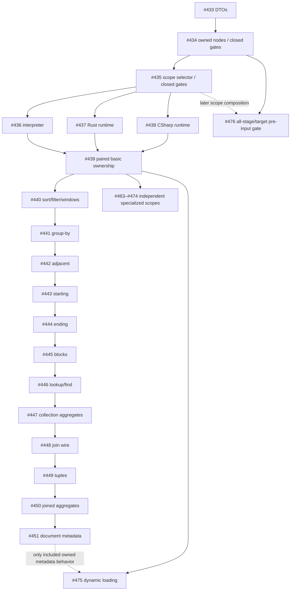

# Explicit source ownership: contributor capability matrix

This [#432](https://github.com/DeandreT/ferrule/issues/432)/#452 snapshot uses P1 head `453db5392139077fed62d006b8ea27c25698abc9`. Reconcile current files before implementation. Existing legacy routes, implemented DTOs and planned ownership execution are distinct.

The P1 foundation ([#433](https://github.com/DeandreT/ferrule/issues/433)) implements strict `SourceOwner`, `OwnedSourceRef` and `SourceSelector` data types without changing Project, Node, Scope or execution. Its 110-test mapping suite and default workspace tests passed. PR456 still awaits backend checks and merge. P2 ([#434](https://github.com/DeandreT/ferrule/issues/434)) has 41 proposed file changes and 26 tests; independent source review and formatting are complete, while test verification is pending. P3 ([#435](https://github.com/DeandreT/ferrule/issues/435)) is being prepared as a separate wire-and-gates increment. Explicit-owner interpreter, generated Rust/C#, native export and GUI authoring are not enabled by these milestones.

## Ownership rules

An owner selects immutable primary or one exact named endpoint. Preserve name bytes; reject empty named owners without trimming, alias/prefix fallback or new path restrictions. Paths are endpoint-local. Owned `[]` differs from inherited/null selection; absent-frame differs from root-frame. Preserve legacy fallback, while owned reads never borrow another endpoint. Generated item IDs, function inputs and JoinId remain separate identities.

Keep structural validity separate from executable capability. Preserve strict new forms and reject unsupported execution/emission, including directly constructed Program validation. P2 checks new-kind potential branches, called functions and demanded paths without changing legacy laziness. Codegen keeps its reachable lowering/metadata rules; native export needs whole-design checks before writing. Preserve saved GUI owner data/IDs/wires read-only; authoring/conversion stays closed.

## Existing coordinated issues

Reuse these existing scopes; the capability column concerns **explicit ownership**.

| Issue / scope | Dependency | Status and capability boundary |
|---|---|---|
| [#433](https://github.com/DeandreT/ferrule/issues/433) DTOs | None | Implemented/tested foundation; no execution integration |
| [#434](https://github.com/DeandreT/ferrule/issues/434) owned field/position nodes | [#433](https://github.com/DeandreT/ferrule/issues/433) | Source reviewed/formatted; tests pending; strict new kinds, schema checks, closed typed gates |
| [#435](https://github.com/DeandreT/ferrule/issues/435) collection/root/nested selector | [#434](https://github.com/DeandreT/ferrule/issues/434) | In preparation; source slot/getters/mutators must preserve owner |
| [#436](https://github.com/DeandreT/ferrule/issues/436) interpreter registry/basic frames | [#435](https://github.com/DeandreT/ferrule/issues/435) | Pending; exact scalar, collection and position reads; separate generated/function contexts |
| [#437](https://github.com/DeandreT/ferrule/issues/437) Rust runtime registry/walks | [#435](https://github.com/DeandreT/ferrule/issues/435) | Pending; preserve legacy context; no emitter opening alone |
| [#438](https://github.com/DeandreT/ferrule/issues/438) C# runtime registry/walks | [#435](https://github.com/DeandreT/ferrule/issues/435) | Pending; separate registry from legacy merged named wrapper |
| [#439](https://github.com/DeandreT/ferrule/issues/439) paired basic lowering/emission | [#436](https://github.com/DeandreT/ferrule/issues/436),[#437](https://github.com/DeandreT/ferrule/issues/437),[#438](https://github.com/DeandreT/ferrule/issues/438) | Pending; scalar AND collection/position/nesting, checked in all three engines |
| [#440](https://github.com/DeandreT/ferrule/issues/440) sort/filter/windows | [#439](https://github.com/DeandreT/ferrule/issues/439) | Pending; parent/item phases and frame provenance |
| [#441](https://github.com/DeandreT/ferrule/issues/441) group-by/post-group filter | [#440](https://github.com/DeandreT/ferrule/issues/440) | Pending; grouped frame and representative item |
| [#442](https://github.com/DeandreT/ferrule/issues/442) adjacent grouping | [#441](https://github.com/DeandreT/ferrule/issues/441) | Pending; adjacent key/item frames |
| [#443](https://github.com/DeandreT/ferrule/issues/443) starting-boundary grouping | [#442](https://github.com/DeandreT/ferrule/issues/442) | Pending; boundary phases/positions |
| [#444](https://github.com/DeandreT/ferrule/issues/444) ending-boundary grouping | [#443](https://github.com/DeandreT/ferrule/issues/443) | Pending; membership and frame positions |
| [#445](https://github.com/DeandreT/ferrule/issues/445) fixed-block grouping | [#444](https://github.com/DeandreT/ferrule/issues/444) | Pending; block/window membership |
| [#446](https://github.com/DeandreT/ferrule/issues/446) Lookup/CollectionFind | [#445](https://github.com/DeandreT/ferrule/issues/445) | Pending; parent needle, owned item predicate/value, missing result Null |
| [#447](https://github.com/DeandreT/ferrule/issues/447) collection aggregates | [#446](https://github.com/DeandreT/ferrule/issues/446) | Pending; item predicate/value versus parent argument; excludes generated sequences |
| [#448](https://github.com/DeandreT/ferrule/issues/448) join wire/identity | [#447](https://github.com/DeandreT/ferrule/issues/447) | Pending; owner+collection and separate JoinId; execution closed |
| [#449](https://github.com/DeandreT/ferrule/issues/449) join tuples | [#448](https://github.com/DeandreT/ferrule/issues/448) | Pending; source-row versus flattened tuple positions |
| [#450](https://github.com/DeandreT/ferrule/issues/450) joined aggregates/correlation | [#449](https://github.com/DeandreT/ferrule/issues/449) | Pending; active-source and argument phases |
| [#451](https://github.com/DeandreT/ferrule/issues/451) document-path metadata | [#450](https://github.com/DeandreT/ferrule/issues/450) | Pending; exact owned-frame metadata; excludes dynamic loading/XML routes |
| [#452](https://github.com/DeandreT/ferrule/issues/452) specialized matrix | Coordination | Plans small follow-ons; opens no execution capability |

## Specialized follow-on issues

The 14 issues below are created and assigned to DeandreT. [#463](https://github.com/DeandreT/ferrule/issues/463)–[#474](https://github.com/DeandreT/ferrule/issues/474) depend directly on [#439](https://github.com/DeandreT/ferrule/issues/439). [#475](https://github.com/DeandreT/ferrule/issues/475) also depends on [#439](https://github.com/DeandreT/ferrule/issues/439); [#451](https://github.com/DeandreT/ferrule/issues/451) is conditional only when an explicitly included owned document-metadata consumer needs it. An operator's special producer is a prerequisite only for combinations using that producer. Common IR/runtime/emitter file edits require coordination, not blanket serialization behind joins or metadata work.

All specialized owned integration, interpreter execution, lowering and Rust/C# runtime/emission below are pending. Native owned export and GUI owner authoring remain separate and closed. The source column locates existing legacy behavior and the proposed edit boundary.

| Issue / operator | Direct dependency | Source ownership / focused missing behavior |
|---|---|---|
| [#463](https://github.com/DeandreT/ferrule/issues/463) RecursiveCollect | [#439](https://github.com/DeandreT/ferrule/issues/439) | `mapping/model/graph.rs`, `engine/sequence.rs`, runtime recursive contexts; owned root collection, relative child/descent/value paths |
| [#464](https://github.com/DeandreT/ferrule/issues/464) RecursiveFilter construction | [#439](https://github.com/DeandreT/ferrule/issues/439) | `engine/recursive_filter.rs`, runtime filter/context; reuse [#435](https://github.com/DeandreT/ferrule/issues/435) selector, retain copied group/items/positions |
| [#465](https://github.com/DeandreT/ferrule/issues/465) PathHierarchy | [#439](https://github.com/DeandreT/ferrule/issues/439) | mapping plan, engine/runtime builders; qualify input collection, not generated output paths |
| [#466](https://github.com/DeandreT/ferrule/issues/466) AdjacencyTree | [#439](https://github.com/DeandreT/ferrule/issues/439) | mapping adjacency and engine/runtime tree; qualify rows, keep key/parent relative and root expression in parent |
| [#467](https://github.com/DeandreT/ferrule/issues/467) DynamicSourceField | [#439](https://github.com/DeandreT/ferrule/issues/439) | graph, resolver/context and emitters; exact object/key/frame lookup, not document loading |
| [#468](https://github.com/DeandreT/ferrule/issues/468) XmlMixedContent expression | [#439](https://github.com/DeandreT/ferrule/issues/439) | expression, XML validation/runtime; exact atomization and replacement occurrence phases |
| [#469](https://github.com/DeandreT/ferrule/issues/469) XmlSerialize expression | [#439](https://github.com/DeandreT/ferrule/issues/439) | expression and XML runtime; owned structured read, unchanged schema/options/error order |
| [#470](https://github.com/DeandreT/ferrule/issues/470) XmlMixedContent construction | [#439](https://github.com/DeandreT/ferrule/issues/439) | scope evaluation and mixed runtime; reuse selector and actual item's XML metadata/children |
| [#471](https://github.com/DeandreT/ferrule/issues/471) failure-rule Source iteration | [#439](https://github.com/DeandreT/ferrule/issues/439) | project, failure runtime/emitters; strict owned iteration beside legacy; first failure before publication |
| [#472](https://github.com/DeandreT/ferrule/issues/472) SequenceExists | [#439](https://github.com/DeandreT/ferrule/issues/439) + used producer gate | sequence/context/reducers; separate generated item from endpoint read; first-true/empty-false behavior |
| [#473](https://github.com/DeandreT/ferrule/issues/473) SequenceItemAt | [#439](https://github.com/DeandreT/ferrule/issues/439) + used producer gate | sequence/context; values before parent index; one-based bounds/Null/error behavior |
| [#474](https://github.com/DeandreT/ferrule/issues/474) SequenceAggregate | [#439](https://github.com/DeandreT/ferrule/issues/439) + used producer gate | sequence/aggregate runtimes; item predicate/value, parent argument; separate from [#447](https://github.com/DeandreT/ferrule/issues/447)/#450 |
| [#475](https://github.com/DeandreT/ferrule/issues/475) dynamic driver loading | [#439](https://github.com/DeandreT/ferrule/issues/439); [#451](https://github.com/DeandreT/ferrule/issues/451) only if needed | dynamic path/source iteration and context walks; driver/loaded owner identity, success-only cache and laziness |
| [#476](https://github.com/DeandreT/ferrule/issues/476) pipeline pre-input gate | [#434](https://github.com/DeandreT/ferrule/issues/434); coordinate [#435](https://github.com/DeandreT/ferrule/issues/435) | CLI `pipeline.rs`/`pipeline_preview.rs`; reject unsupported owned stages/targets before read/decode |

Source shorthand omits `crates/` and `src/`; issues supply exact file lists. Reconcile callers/C# runtime helpers; registration alone is not equivalence. Key anchors: `mapping/src/source_owner.rs:18,106,165`, `engine/src/resolve.rs:8,39,158,190`, `codegen/src/lower.rs:17,732,794,1026`.

Legacy native planners have restrictions and warning/refusal paths, not explicit-owner support. DynamicSourceField warns/skips; some sequence renderers skip unexported items. Preserve that behavior and add strict owned gates without claiming universal legacy refusal or partial owned export.

Ordinary sequence arguments and dynamic bindings/children use core reads/frames. Preserve Generate-only FilterMap, CopyCurrentSource/concat contexts and deliberate primary-only helpers; add no arbitrary endpoint producer.

## Pipeline admission is all-stage, all-target

The engine evaluates **every stage and every primary/named stage target**, including disconnected stages and targets not selected for publication (`engine/src/pipeline.rs:116–136`). Selected outputs control publication only. [#476](https://github.com/DeandreT/ferrule/issues/476) must not introduce pruning.

The filesystem and preview host seams validate, then read/decode, then call the engine (`cli/src/pipeline.rs:336,356,431`; `pipeline_preview.rs:247,424,452`). Add P2 capability checks before acquisition, preserving structural/identity precedence and engine refusal before evaluation/publication. The four existing P2 host routes do not establish this pipeline guarantee.

Test an unselected/disconnected owned stage or named target: refuse before reader/parser/loader/debug/trace callbacks, leave output markers unchanged and produce no preview result. Cover every engine-evaluated stage/target's called graphs and new-kind branches, preserving P2 valid-unused-storage rules and legacy laziness. [#476](https://github.com/DeandreT/ferrule/issues/476) enables neither owned execution nor pruning.

## Implementation progress

- [x] Define strict owner/path DTOs and pass the 110-test mapping suite; merge remains pending.
- [x] Review and format the owned node wire-and-gates proposal; execution remains closed.
- [x] Create the 14 specialized issues with scopes, dependencies and acceptance checklists.
- [ ] Complete P2 test verification and merge its separate increment.
- [ ] Qualify the owned scope selector, basic interpreter and both generated runtimes.
- [ ] Compare full interpreter/Rust/C# results before opening each specialized operator.
- [ ] Qualify native export and GUI ownership authoring separately.

## Acceptance checklist

- [ ] Reconcile one focused scope/current callers and coordinate common files; add only real semantic prerequisites.
- [ ] Specify complete expected values/errors for colliding owners, missing selected owner, root/nested/group frames, positions, phases, limits and laziness.
- [ ] Preserve strict new wire, old-reader refusal and legacy behavior. Keep unsupported execution/emission rejected while dependencies land.
- [ ] Split representation/gates, interpreter/runtime and paired emission into buildable PRs where needed. Compare complete three-engine results before opening only that operator.
- [ ] Gate native export/GUI authoring separately; preserve saved owner data/IDs/wires. Run focused checks and required CI, then update status from results.

