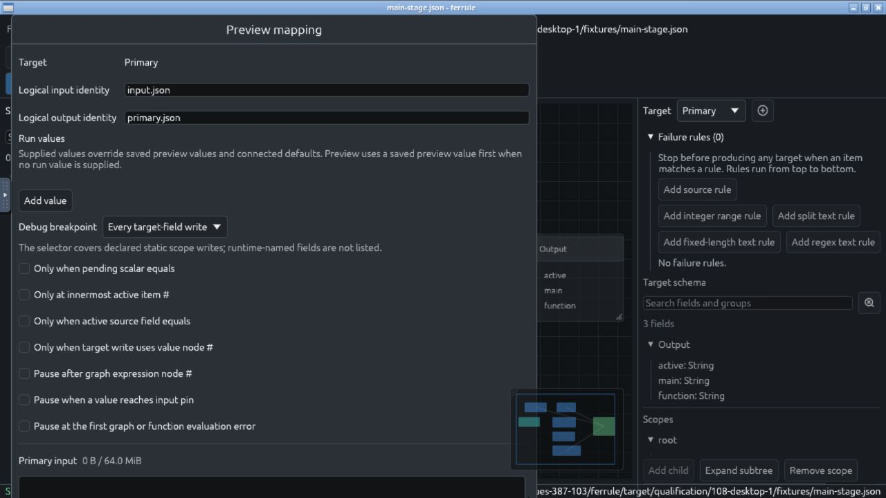
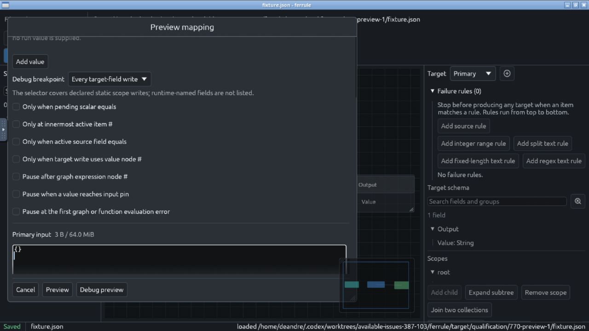
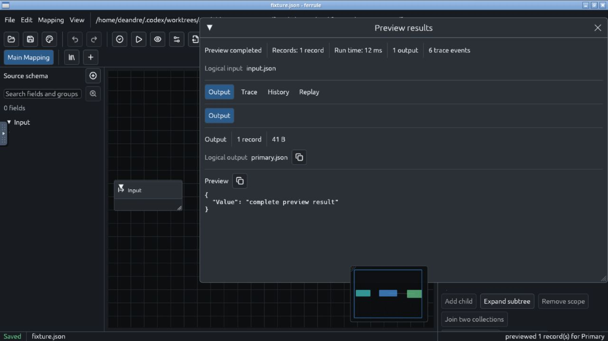

# Preview controls on shorter windows: 2026-10-15

The Preview setup now scrolls vertically, keeping its input and actions
reachable on a short desktop. Its nested input editor also has a finite height
when the outer scrolling window offers unbounded content space.
This is the focused correction for [#770](https://github.com/DeandreT/ferrule/issues/770).

On main `4c1aa380`, the original 1280 × 720 native session showed the input
starting below the screen and no reachable action row. The real-theme widget
regression independently reproduced a 792-pixel window in a 699-pixel client;
both action tests failed before the production change.



The rebuilt ordinary GUI used its own X11 display, session bus and Zenity chooser.
At the same native display size, fifteen outer wheel events exposed the editor,
Cancel, Preview and Debug preview. Entering the complete three-byte `{}\n` input
and clicking Cancel returned to the clean project. Reopening and entering that
input again, then clicking Preview, completed one record and one 41-byte output.



The [complete desktop fixture](preview-window-2026-10-15.mapping.json) has an empty
input group and one string output bound to the literal `complete preview result`.
The app's actual **Copy preview** button transferred the full result into the
visible noVNC clipboard textarea. Its original text was retained before comparing
every byte against this independent expected value, including the final newline:

```json
{
  "Value": "complete preview result"
}
```



The original fixture, input and expected bytes stayed unchanged. The GUI exited
normally, every owned desktop process group closed, and all bound source files
and the retained executable matched their pre-session identities.

Validation also includes two real-layout widget tests at 1280 × 699 and
960 × 560 client sizes, with actual scroll/button events, complete input/output
comparison and complete project equality after Cancel. All 800 GUI tests passed
before the equivalent existing test-helper lint correction in
[PR #772](https://github.com/DeandreT/ferrule/pull/772). The final stack passed the
two Preview regressions, strict GUI all-target Clippy without suppressions,
formatting and a normal GUI build; the lint-only parent separately passed both
existing aggregate-authoring tests.

The [evidence index](preview-window-2026-10-15.evidence.json) records source and
executable identities, original image/fixture hashes, commands, process closure
and retained failures. Earlier attempts include the initial wheel-event compile
error, three memory-reserve interruptions, a private monitor race during normal
temporary-file removal, and the separately corrected baseline lint warning.
Interrupted fixture originals were copied from RAM-backed `/tmp` to disk and
verified individually before releasing their old locations. The successful full
run used disk-backed temporary space and a monitor that tolerates disappearing
temporary files; the memory, disk and evidence reserves stayed enforced.

This qualifies the recorded Preview reachability and tiny constant-output
workflow. The full mapping-path authoring/persistence workflow in
[#108](https://github.com/DeandreT/ferrule/issues/108), other desktop platforms,
and broader Basic and observer acceptance retain their separate gates.
